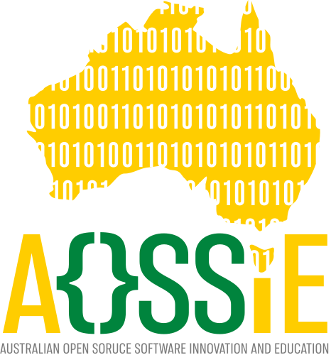
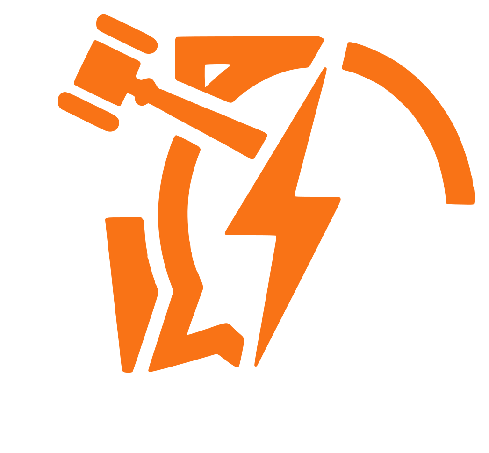

<!-- Don't delete it -->
<div id="readme-top"></div>

<!-- Organization & Project Logos -->
<p align="center">
  
  &nbsp;&nbsp;&nbsp;&nbsp;
  
</p>

<!-- Live at URL (To be configured later) -->
<p align="center">
  <!-- Live at URL will be configured later -->
  <a href="https://hub.debateai.aossie.org/">
    
  </a>
  <a href="https://debateai.aossie.org/">
    
  </a>
</p>

<!-- Community & Social Handles -->
<p align="center">
  <a href="https://discord.gg/hjUhu33uAn"></a>
  &nbsp;
  <a href="https://x.com/aossie_org"></a>
  &nbsp;
  <a href="https://t.me/+bMWGzaMTMa8xN2Ex"></a>
  &nbsp;
  <a href="https://www.linkedin.com/company/aossie/"></a>
  &nbsp;
  <a href="https://www.youtube.com/@AOSSIE-Org"></a>
  &nbsp;
  <a href="https://www.youtube.com/@StabilityNexus"></a>
</p>

---

## About DebateAI

**DebateAI** is an AI-enhanced, real-time debating platform designed to sharpen communication skills. Whether competing against human opponents or LLM-powered AI challengers, users can participate in structured debates that mimic formal competitions.

### Key Features

- **User vs. User Debates**
  - Real-time debates via **WebSockets**, **WebRTC** (audio/video/text)
  - Structured formats: **opening**, **cross-exam**, and **closing**

- **User vs. AI Debates**
  - LLM-generated counterarguments that adapt to your input

- **Custom Debate Rooms**
  - Create private, topic-specific debate spaces

---

## Community & Discussion

If you have questions, feedback, or want to discuss ideas before building:
- **AOSSIE Discord Server:** [https://discord.gg/hjUhu33uAn](https://discord.gg/hjUhu33uAn)
- **Discord Channel:** `#AI for Debate` channel in the [AOSSIE Server](https://discord.com/channels/1022871757289422898/1312986807914463252)
- **GitHub Issues:** [https://github.com/AOSSIE-Org/DebateAI/issues](https://github.com/AOSSIE-Org/DebateAI/issues)

---

## Project Setup Guide

You can run DebateAI locally using either **Docker Compose** (recommended for a one-command full-stack environment) or via **Manual Local Setup**.

---

### Option 1: Quick Start with Docker (Recommended)

DebateAI includes pre-configured Dockerfiles for both frontend and backend along with a root `docker-compose.yml` that starts the Backend, Frontend, MongoDB, and Redis automatically.

#### 1. Setup Environment Files

```bash
# 1. Setup Backend environment & config:
cd backend
cp .env.example .env
cp config/config.prod.sample.yml config/config.prod.yml
cd ..

# 2. Setup Frontend environment:
cd frontend
cp .env.example .env
cd ..
```

#### 2. Run with Docker Compose

From the root project directory:

```bash
docker compose up --build
```

- **Frontend:** [http://localhost:5173](http://localhost:5173)
- **Backend Server:** [http://localhost:1313](http://localhost:1313)
- **MongoDB:** `localhost:27017`
- **Redis:** `localhost:6379`

To stop:

```bash
docker compose down
```

---

### Option 2: Manual Local Setup

#### Prerequisites
- **Go** (version 1.20 or later, 1.24 recommended)
- **Node.js** (version 20 or later) & **npm**
- **MongoDB** (local instance or MongoDB Atlas)
- **Redis** (local instance or cloud Redis)

---

### Backend Configuration

#### 1. Create Backend Config & Environment Files

```bash
cd backend
cp .env.example .env
cp config/config.prod.sample.yml config/config.prod.yml
```

#### 2. Configure MongoDB

Update `backend/config/config.prod.yml` with a valid MongoDB connection string:

```yaml
database:
  uri: "<YOUR_MONGODB_URI>"
```

Without a valid MongoDB URI, the backend will fail to start.

#### 3. Configure Redis

Update `backend/config/config.prod.yml` with your Redis address:

```yaml
redis:
  addr: "localhost:6379"
  password: ""
  db: 0
```

#### 4. Configure Gemini API (Optional)

Configure your Gemini API key for AI debate features:

```yaml
gemini:
  apiKey: "<YOUR_GEMINI_API_KEY>"
```

#### 5. Run the Backend Server

From the `backend` directory, start the server:

```bash
go run cmd/server/main.go
```

The server will start on the port defined in the config file (default: `1313`).

> **Note:** Do **not** commit `config.prod.yml` or `.env` to version control.

---

### Frontend Configuration (React + Vite)

#### 1. Navigate to the Frontend Directory and Install Dependencies

```bash
cd frontend
npm install
```

#### 2. Setup Environment Variables

Copy the example environment file:

```bash
cp .env.example .env
```

Ensure `frontend/.env` contains the required URLs:

```env
VITE_BASE_URL="http://localhost:1313"
VITE_API_URL="http://localhost:1313"
VITE_GOOGLE_CLIENT_ID="<YOUR_GOOGLE_OAUTH_CLIENT_ID>"
```

#### 3. Start the Development Server

```bash
npm run dev
```

The frontend will run on [http://localhost:5173](http://localhost:5173).

---

## Contribution Guidelines

Thank you for your interest in contributing to **DebateAI**! Please refer to our detailed [`CONTRIBUTING.md`](CONTRIBUTING.md) for full contribution guidelines, testing procedures, coding standards, and Git workflows.

### Quick Contribution Steps

1. **Fork the Repository:** Fork [DebateAI](https://github.com/AOSSIE-Org/DebateAI) and clone your fork locally:
   ```bash
   git clone https://github.com/<your-username>/DebateAI.git
   cd DebateAI
   ```
2. **Create a Feature Branch:**
   ```bash
   git checkout -b feat/your-feature-name
   ```
3. **Run Code Validation:**
   - **Backend:** `cd backend && go test ./... && go vet ./...`
   - **Frontend:** `cd frontend && npm run lint && npm run build`
4. **Push and Open a Pull Request:** Push to your fork and open a PR against `main`.

---

### Submitting a Video Demonstration

To help maintainers review and understand your changes, please consider submitting a short video demo showcasing your feature or fix in your Pull Request description.

---

### Reporting Issues

If you find a bug or have a feature request:
- Open an issue on [GitHub Issues](https://github.com/AOSSIE-Org/DebateAI/issues).
- Clearly describe the problem, steps to reproduce, and suggest solutions if possible.

---

## License

MIT © [AOSSIE](https://aossie.org)
